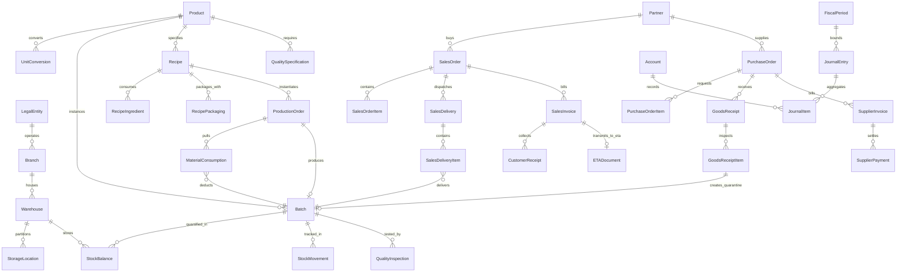

# Database Entity Relationship Diagram & Schema Specification

This document provides the complete data model for the Egyptian Agrochemical Manufacturing ERP, capturing relationships, primary/foreign keys, uniqueness constraints, and field precision.

---

## 1. High-Level Entity-Relationship Model

---

## 2. Relational Domain Definitions

### Core Master Data
- **`LegalEntity`**: Egyptian legal corporate entity (`code`, `name_ar`, `name_en`, `tax_id`, `commercial_register`, `currency`, `address`).
- **`Branch`**: Operational branches & formulation plants (`legal_entity_id`, `code`, `name_ar`, `is_factory`).
- **`Warehouse`**: Segregated physical facilities (`branch_id`, `code`, `name_ar`, `warehouse_type`: `RAW_MATERIALS`, `ACTIVE_INGREDIENTS`, `PACKAGING`, `WIP`, `FINISHED_GOODS`, `QUARANTINE`, `QUALITY_HOLD`, `DAMAGED_REJECTED`, `EXPIRED`).
- **`Product`**: Agrochemical master record (`code`, `name_ar`, `category`, `regulatory_type`, `formulation_type`, `density` in kg/L, `target_ph`, `viscosity`, `active_ingredient_composition`, `registration_number`, `standard_cost`, `selling_price`).
- **`ProductUOMConversion`**: Product-specific packaging conversion factor (`product_id`, `from_uom_id`, `to_uom_id`, `conversion_factor`).
- **`Partner`**: Customers & Suppliers (`code`, `name_ar`, `partner_type`, `customer_class`, `tax_id`, `commercial_register`, `national_id`, `credit_limit`, `credit_days`, `territory`).

### Perpetual Inventory
- **`Batch`**: Chemical formulation/raw lot record (`product_id`, `batch_number`, `supplier_lot_number`, `manufacturing_date`, `expiry_date`, `status`: `QUARANTINE`, `RELEASED`, `QUALITY_HOLD`, `REJECTED`, `EXPIRED`).
- **`StockBalance`**: Atomic on-hand balance (`product_id`, `warehouse_id`, `storage_location_id`, `batch_id`, `quantity_on_hand`, `quantity_reserved`, `valuation_unit_cost`).
- **`StockMovement`**: Perpetual movement ledger (`timestamp`, `movement_type`, `product_id`, `warehouse_id`, `batch_id`, `quantity`, `uom_id`, `unit_cost`, `total_cost`, `source_document`).

### Manufacturing & Formulations
- **`Recipe`**: Versioned chemical formulation BOM (`product_id`, `version`, `reference_batch_size`, `expected_yield_percent`, `status`: `DRAFT`, `APPROVED`, `OBSOLETE`).
- **`RecipeIngredient`**: Ingredient line (`recipe_id`, `raw_material_id`, `quantity_required`, `phase`, `is_active_ingredient`).
- **`RecipePackaging`**: Packaging line (`recipe_id`, `packaging_material_id`, `quantity_required`, `label_revision`, `is_label_approved`).
- **`ProductionOrder`**: Batch mixing execution order (`order_number`, `recipe_id`, `product_id`, `warehouse_raw_id`, `warehouse_fg_id`, `target_quantity`, `actual_output_quantity`, `scrap_quantity`, `status`, `recipe_snapshot`).
- **`MaterialConsumption`**: Actual chemical usage (`production_order_id`, `product_id`, `batch_id`, `actual_quantity`, `unit_cost`, `total_cost`).

### Double-Entry Accounting
- **`Account`**: Chart of accounts (`code`, `name_ar`, `name_en`, `account_type`: `ASSET`, `LIABILITY`, `EQUITY`, `REVENUE`, `EXPENSE`, `parent_id`, `is_reconcilable`).
- **`JournalEntry`**: Balanced journal entry (`entry_number`, `entry_date`, `fiscal_period_id`, `status`: `DRAFT`, `POSTED`, `REVERSED`, `reference_document`, `idempotency_key`, `reversal_of_id`).
- **`JournalItem`**: Entry line (`entry_id`, `account_id`, `partner_id`, `debit`, `credit`, `memo`).
- **`BankCashAccount`**: Treasury or bank account (`code`, `name_ar`, `gl_account_id`, `currency`, `account_number`).
