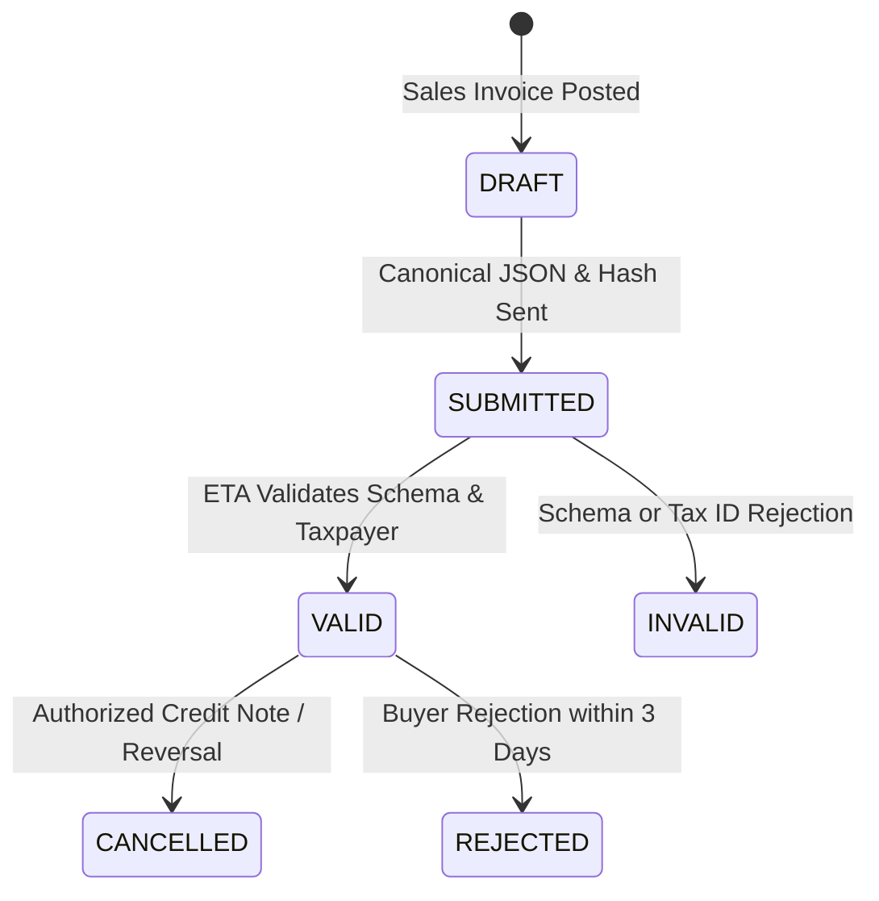

# Egyptian Tax Authority (ETA) E-Invoicing & E-Receipt Specification

This document defines the integration architecture between the Agrochemical ERP and the Egyptian Tax Authority (مصلحة الضرائب المصرية) e-Invoicing system.

---

## 1. Regulatory Context & Egyptian Tax Codes

- **Authority**: Egyptian Tax Authority (ETA) - منظومة الفاتورة والإيصال الإلكتروني.
- **API Version**: ETA v1.0 JSON Specification.
- **Default Corporate Taxpayer Activity Code**: `2012` (صناعة وتعبئة الكيماويات والأسمدة والمبيدات الزراعية).
- **Default Company Tax ID**: 9-digit Egyptian Tax Registration Number (e.g. `100-200-300`).
- **Standard Value Added Tax (VAT / ض.ق.م)**:
  - Code: `T1`
  - Subtype: `V009` (General Rate - 14%).
- **Withholding Tax (WHT / ضريبة الخصم والتحصيل من المنبع - أرباح تجارية وصناعية)**:
  - Code: `T4`
  - Subtype: `W001` (Contracting & Supply - 1%).
  - Deducted by customers from invoice payouts and credited against corporate income tax.

---

## 2. Document Submission Lifecycle



---

## 3. Canonical JSON Structure Example

```json
{
  "issuer": {
    "address": {
      "branchID": "0",
      "country": "EG",
      "governorate": "Giza",
      "regionCity": "6th of October Industrial Zone",
      "streetName": "Industrial Area",
      "buildingNumber": "1"
    },
    "type": "B",
    "id": "100200300",
    "name": "شركة مصر للصناعات الكيماوية والزراعية ش.م.م"
  },
  "receiver": {
    "address": {
      "country": "EG",
      "governorate": "Beheira",
      "regionCity": "Nobariya",
      "streetName": "Desert Road",
      "buildingNumber": "1"
    },
    "type": "B",
    "id": "450670890",
    "name": "شركة الدلتا للتنمية والاستثمار الزراعي"
  },
  "documentType": "I",
  "documentTypeVersion": "1.0",
  "dateTimeIssued": "2026-01-16T10:00:00Z",
  "taxpayerActivityCode": "2012",
  "internalID": "INV-2026-001",
  "invoiceLines": [
    {
      "description": "مبيد بيريفوس 48% مركز قابل للاستحلاب EC",
      "itemType": "EGS",
      "itemCode": "EG-100200300-FP-PYRI-48EC",
      "unitType": "L",
      "quantity": 100.0,
      "unitValue": { "currencySold": "EGP", "amountEGP": 320.0 },
      "salesTotal": 32000.0,
      "total": 36480.0,
      "netTotal": 32000.0,
      "taxableItems": [
        { "taxType": "T1", "amount": 4480.0, "subType": "V009", "rate": 14.0 }
      ]
    }
  ],
  "totalSalesAmount": 32000.0,
  "netAmount": 32000.0,
  "taxTotals": [
    { "taxType": "T1", "amount": 4480.0 },
    { "taxType": "T4", "amount": 320.0 }
  ],
  "totalAmount": 36480.0
}
```

---

## 4. Security & Cryptographic Signing
- Digital signatures using Egypt Trust or Misr Sign HSM hardware tokens / PKCS#11 or PFX software certificates are applied on the backend layer before transmission.
- Private keys and PINs are stored exclusively in host environment variables and never exposed over client APIs.
